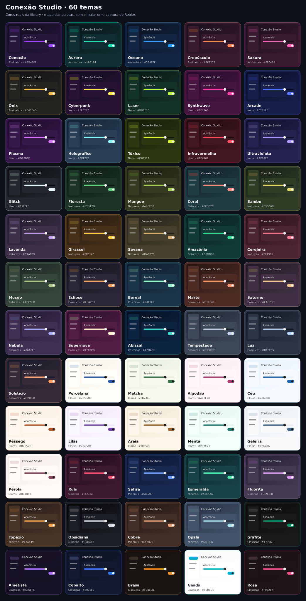

# Os 60 temas da Conexão Studio

Cada miniatura usa as cores do catálogo real. Este mapa é uma referência das paletas; não é uma captura do cliente Roblox. Na library, as prévias são feitas com GuiObjects e aplicam o tema ao tocar.



Abra **Configurações → Ver todos os temas**. A busca aceita nome, ID, cores e estilo, com ou sem acentos. Os filtros de família podem ser combinados com a busca. A escolha é aplicada imediatamente e fica salva.

| Tema | ID | Família | Paleta |
| --- | --- | --- | --- |
| Conexão | `conexao` | Assinatura | Violeta elétrico e azul |
| Aurora | `aurora` | Assinatura | Verde luminoso e turquesa |
| Oceano | `oceano` | Assinatura | Azul vivo e ciano |
| Crepúsculo | `crepusculo` | Assinatura | Coral e violeta ao anoitecer |
| Sakura | `sakura` | Assinatura | Rosa intenso e lavanda |
| Ônix | `onyx` | Assinatura | Dourado e âmbar sobre carvão |
| Cyberpunk | `cyberpunk` | Neon | Amarelo ácido e magenta |
| Laser | `laser` | Neon | Lima elétrico e azul-gelo |
| Synthwave | `synthwave` | Neon | Pink e laranja sobre ameixa |
| Arcade | `arcade` | Neon | Azul elétrico e chiclete |
| Plasma | `plasma` | Neon | Orquídea e verde ácido |
| Holográfico | `holografico` | Neon | Ciano perolado e lilás |
| Tóxico | `toxico` | Neon | Chartreuse e verde radioativo |
| Infravermelho | `infravermelho` | Neon | Escarlate e tangerina |
| Ultravioleta | `ultravioleta` | Neon | Íris e turquesa em azul-noite |
| Glitch | `glitch` | Neon | Branco elétrico e vermelho |
| Floresta | `floresta` | Natureza | Samambaia e jade profundo |
| Mangue | `mangue` | Natureza | Verde cítrico e ocre |
| Coral | `coral` | Natureza | Salmão e azul de recife |
| Bambu | `bambu` | Natureza | Amarelo-lima e verde folha |
| Lavanda | `lavanda` | Natureza | Malva e sálvia sobre berinjela |
| Girassol | `girassol` | Natureza | Ouro solar e terracota |
| Savana | `savana` | Natureza | Âmbar e oliva em terra escura |
| Amazônia | `amazonia` | Natureza | Esmeralda e azul de rio |
| Cerejeira | `cerejeira` | Natureza | Carmim e pêssego sobre vinho |
| Musgo | `musgo` | Natureza | Verde mineral e eucalipto |
| Eclipse | `eclipse` | Cósmicos | Cobre e índigo sobre grafite |
| Boreal | `boreal` | Cósmicos | Menta polar e azul intenso |
| Marte | `marte` | Cósmicos | Ferrugem e rosa sobre argila |
| Saturno | `saturno` | Cósmicos | Champanhe e lavanda cósmica |
| Nébula | `nebula` | Cósmicos | Pervinca e pêssego estelar |
| Supernova | `supernova` | Cósmicos | Marfim e laranja sobre amora |
| Abissal | `abissal` | Cósmicos | Turquesa e azul nas profundezas |
| Tempestade | `tempestade` | Cósmicos | Prata e lilás sobre ardósia |
| Lua | `lua` | Cósmicos | Azul lunar e branco frio |
| Solstício | `solsticio` | Cósmicos | Caqui e ouro sobre noite azul |
| Porcelana | `porcelana` | Claros | Azul real e ouro sobre marfim |
| Matcha | `matcha` | Claros | Verde chá e oliva sobre sálvia |
| Algodão | `algodao` | Claros | Framboesa e ameixa sobre rosa |
| Céu | `ceu` | Claros | Azul cerúleo e índigo no branco |
| Pêssego | `pessego` | Claros | Laranja queimado e terracota |
| Lilás | `lilas` | Claros | Violeta e uva sobre névoa lilás |
| Areia | `areia` | Claros | Canela e petróleo sobre linho |
| Menta | `menta` | Claros | Verde-petróleo e azul suave |
| Geleira | `geleira` | Claros | Azul-aço e ardósia sobre gelo |
| Pérola | `perola` | Claros | Bordô e bronze sobre madrepérola |
| Rubi | `rubi` | Minerais | Carmesim e ouro em vinho negro |
| Safira | `safira` | Minerais | Azul safira e champanhe |
| Esmeralda | `esmeralda` | Minerais | Verde joia e ciano em petróleo |
| Fluorita | `fluorita` | Minerais | Ameixa e verde cristalino |
| Topázio | `topazio` | Minerais | Âmbar tostado e azul mineral |
| Obsidiana | `obsidiana` | Minerais | Prata e gelo sobre preto puro |
| Cobre | `cobre` | Minerais | Cobre polido e verdete |
| Opala | `opala` | Minerais | Azul leitoso e rosa opalescente |
| Grafite | `default` | Clássicos | Carvão neutro e verde discreto |
| Ametista | `amethyst` | Clássicos | Violeta clássico em fundo escuro |
| Cobalto | `cobalt` | Clássicos | Azul clássico e aço |
| Brasa | `ember` | Clássicos | Laranja clássico e cinzas quentes |
| Geada | `frost` | Clássicos | Branco frio e ciano clássico |
| Rosa | `rose` | Clássicos | Rosa clássico e tons de vinho |

Também é possível aplicar por código:

```lua
window:ChangeTheme("cyberpunk")
window:OpenThemes()
```

Os IDs anteriores continuam funcionando. Para ignorar o tema salvo e sempre usar o escolhido pelo seu script, passe `rememberTheme = false` em `CreateWindow`.
