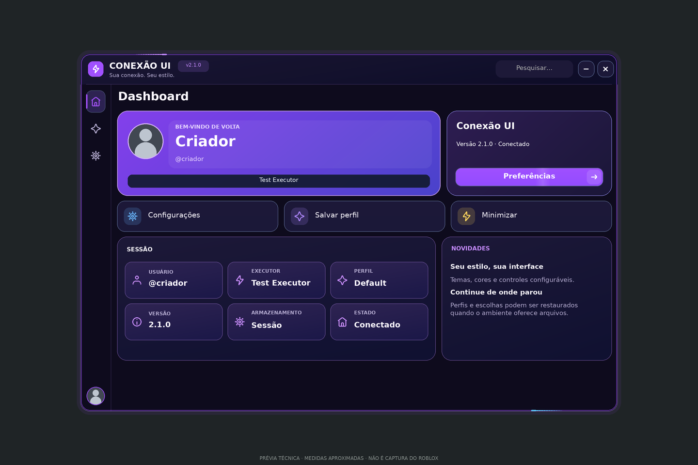
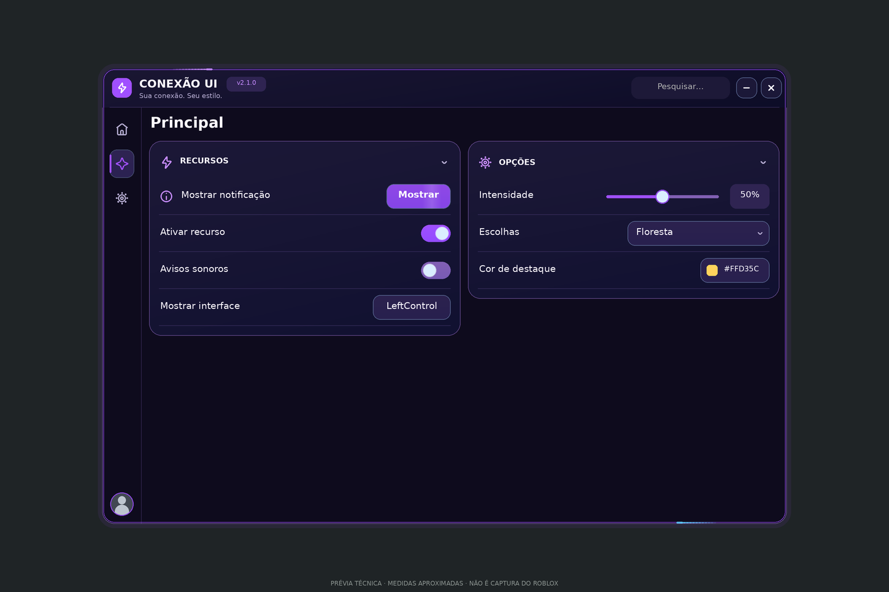
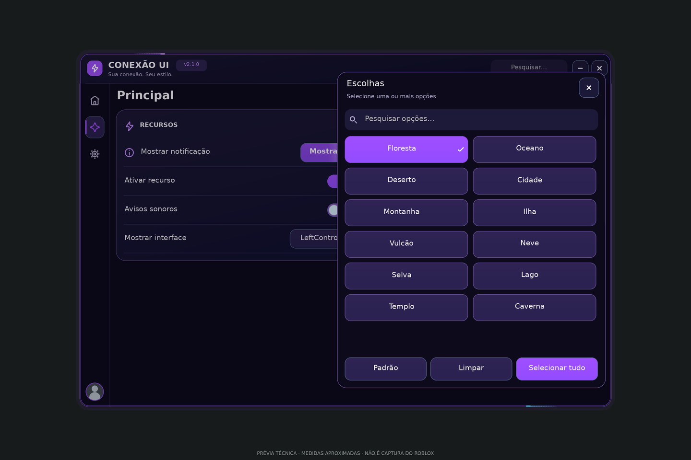
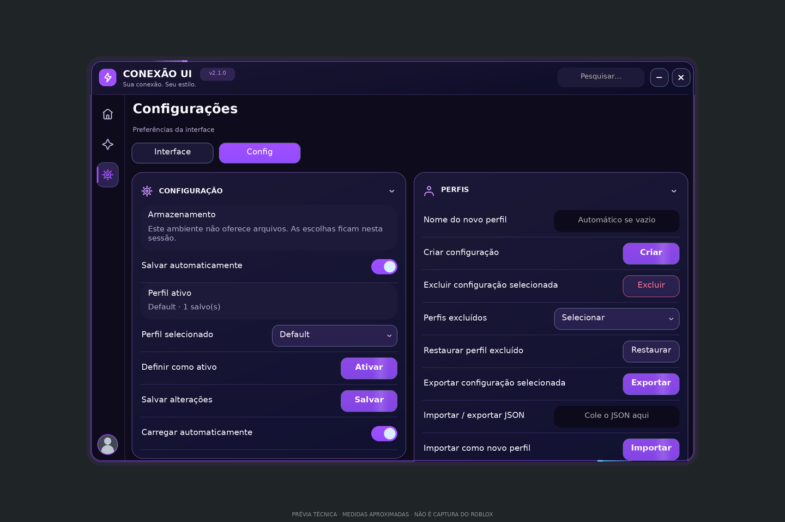
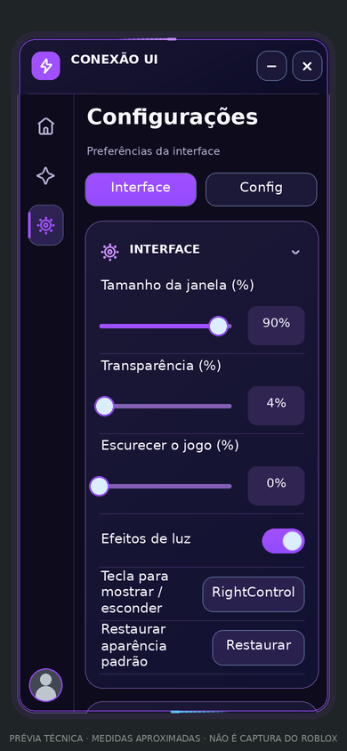

# Visual 2.1

As imagens abaixo são **prévias técnicas aproximadas**, geradas a partir das propriedades de GUI da distribuição Luau. Não são capturas do Roblox. A fonte é substituta, o avatar é ilustrativo e o fundo é artificial. Gradientes, métricas de texto, imagens, rolagem e toque precisam ser conferidos no cliente real.

A 2.1 usa fundos escuros em violeta, botões roxos com gradiente e bordas luminosas, letras maiores e títulos em negrito. Os ícones internos são desenhos locais de contorno; sidebar, cabeçalhos e ações usam centros definidos pelo tamanho do botão. IDs de imagens continuam aceitos.

## Dashboard automático

`CreateWindow` fornece o perfil, as ações rápidas e os cards de estado. No Roblox, o avatar e os nomes vêm do jogador; o executor só é identificado quando o ambiente fornece essa informação.



## Componentes criados pelo script

Cards escuros com uma borda, títulos compactos, separadores discretos e botões preenchidos com brilho suave. Switches mostram a cápsula na cor de destaque e o marcador azul claro, sem uma segunda caixa externa. Gradientes sutis nos cards e botões dão profundidade às superfícies. Sliders usam trilho fino; cores aparecem em uma amostra pequena com hexadecimal. Os controles de exemplo da imagem pertencem ao script de prévia.



```luau
local tab = window:CreateTab({Name = "Principal", Icon = "star"})
local group = tab:CreateGroup({Name = "RECURSOS", Icon = "bolt"})
group:CreateButton({
    Name = "Mostrar notificação", Text = "Mostrar", Icon = "info",
    Callback = function() window:Notify({Content = "Olá!"}) end,
})
group:CreateToggle({Name = "Ativar recurso", Default = true})
```

Os botões comuns e `Variant = "Primary"` usam preenchimento de destaque. Use `Secondary` para fundo neutro e contorno. `Destructive` usa texto e contorno vermelhos.

## Dropdown com pesquisa

Setas, busca, marca de seleção e fechamento usam o mesmo conjunto de desenhos de contorno. A seleção ganha a cor do tema e texto com contraste automático; o painel mantém pesquisa, rolagem e ações de seleção múltipla.



## Configurações e perfis nativos

Seleção, ativação e salvamento ficam no card Configuração. Criação, exclusão, restauração e importação/exportação ficam no card Perfis. O campo JSON continua editável e selecionável para copiar seu conteúdo.



## Tela pequena

As colunas passam a uma; sliders e campos largos vão para baixo do rótulo. A página rola para acessar o restante dos controles. O tamanho inicial evita ocupar monitores grandes inteiros, e o slider nativo permite ajustá-lo até 100% da área disponível.



## Luz em movimento

Dois rastros percorrem a borda, enquanto um brilho suave atravessa os botões preenchidos. O halo acompanha o arraste e o tamanho da janela. O painel permanece parado durante a animação. **Interface → Efeitos de luz** permite desligar; a preferência é salva. As imagens são quadros estáticos da simulação e não mostram o movimento real no Roblox.

## Gerar novas prévias

Instale Pillow no ambiente de desenvolvimento e tenha o Luau CLI disponível. O script não usa navegador nem baixa imagens:

```sh
python3 tools/bundle.py
python3 tools/render_preview.py --page home --luau /workspace/tools/luau/luau --output /tmp/conexao-home
python3 tools/render_preview.py --page controls --luau /workspace/tools/luau/luau --output /tmp/conexao-controls
python3 tools/render_preview.py --page dropdown --luau /workspace/tools/luau/luau --output /tmp/conexao-dropdown
python3 tools/render_preview.py --page profiles --luau /workspace/tools/luau/luau --output /tmp/conexao-profiles
python3 tools/render_preview.py --page settings --width 390 --height 844 --luau /workspace/tools/luau/luau --output /tmp/conexao-mobile
```

Cada chamada produz `.json`, `.html` e `.png`. O renderizador compartilha o host dos testes de geometria e serve para encontrar problemas de proporção e sobreposição; ele não substitui a execução da demo no Roblox.
